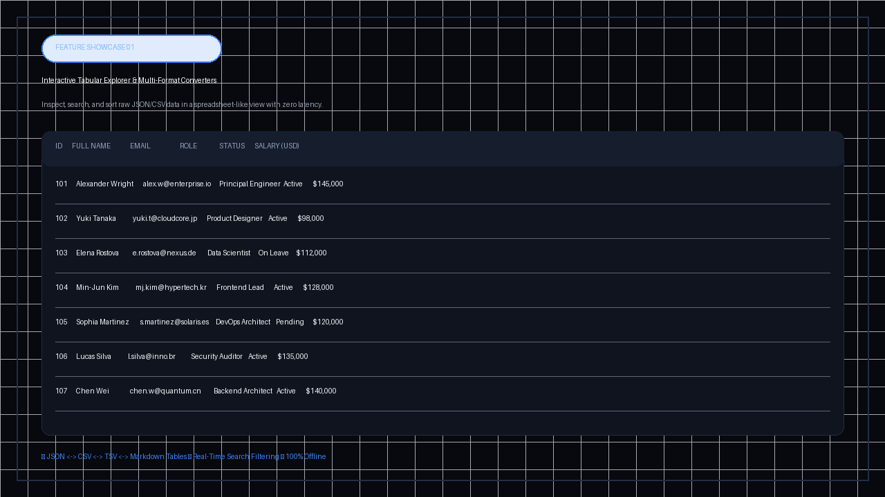
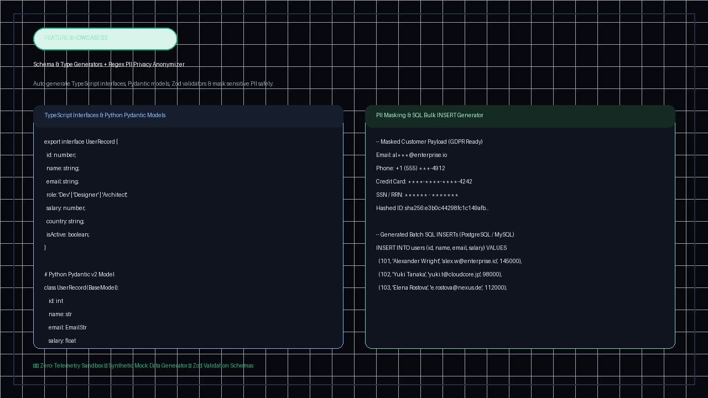

# 📊 DataStudio — Offline Data Engineering, Schema Validator & Converter

> **100% Offline, Zero-Telemetry Data Workspace for JSON, CSV, YAML, Markdown, and Schema Generation.**  
> Designed for privacy-conscious developers, security teams, and data engineers.

---

## 🌐 7 Languages Supported
Instant one-click UI language switching:
- **English** (Default)
- **Español**
- **Français**
- **Português**
- **简体中文**
- **日本語**
- **한국어**

---

## 🚀 Live Interactive Demo
Try the free edition directly in your browser:  
👉 **[Open Live Demo on GitHub Pages](https://tinkomi.github.io/datastudio-offline-converter/)**

---

## ✨ Why DataStudio?
Never upload confidential client payloads, customer records, or proprietary JSON to online converters again. DataStudio runs entirely inside your browser's sandboxed JavaScript runtime with zero network traffic.

- **Bidirectional Conversion**: Convert between JSON, CSV, TSV, and Markdown tables seamlessly.
- **Interactive Tabular Explorer**: Search, filter, and inspect structured datasets in a spreadsheet-like view.
- **Format & Minify**: Clean up indented JSON or compress payloads for production APIs.
- **Privacy Guaranteed**: Fully compliant with GDPR, HIPAA, and internal security policies.

---

---

## 📸 Visual Walkthrough & Feature Showcase

### 1. Interactive Tabular Explorer & Multi-Format Converter

### 2. Schema Generators (TS, Pydantic, Zod) & Regex PII Masking

## ⚖️ Edition Comparison

| Feature | DataStudio Lite (Free) | DataStudio PRO ($12) |
| :--- | :---: | :---: |
| **Deployment** | 100% Offline Single HTML | 100% Offline Single HTML |
| **Languages** | 7 Languages | 7 Languages |
| **JSON / CSV / Markdown Converters** | ✅ Yes | ✅ Yes |
| **Interactive Tabular Viewer** | ✅ Yes (Search & Filter) | ✅ Yes (Multi-column sorting & stats) |
| **TypeScript & Pydantic Type Generators** | — | ✅ Instant TS interfaces & Python Pydantic v2 |
| **Schema Generators** | — | ✅ JSON Schema Draft-07 & Zod Validator code |
| **SQL Bulk Insert Generator** | — | ✅ PostgreSQL, MySQL & SQLite batch INSERTs |
| **Regex PII Anonymizer & Masking** | — | ✅ Mask Emails, Phones, Credit Cards & SSN/RRN |
| **Mock Data Synthesizer** | — | ✅ Synthesize SaaS, E-Com & Audit Log datasets |
| **License** | Open Source / Personal | Commercial & Enterprise Allowed |

---

## 📥 Get DataStudio
- **Free Lite Edition**: [Download Free on GitHub](https://tinkomi.github.io/datastudio-offline-converter/) or clone this repo.
- **PRO Edition ($12)**: 👉 [Purchase DataStudio PRO on Gumroad ($12)](https://mcjinster.gumroad.com/l/wrqkpr)

## 📄 License
MIT License — Copyright (c) 2026 tinkomi.
